# CN Project: Final Evidence Report (Phase 1 and Phase 2)

Team 1 · Private Network Service Platform · 25 Nov 2026 · generated from `evidence/build_report.py`. Open `evidence/index.html` for the illustrated version.

## 1. What we built (in one minute)

A client opens `https://app.team1.test:8443`. **Our own DNS** (Mac 1) turns the name into the edge's IP. The **nginx edge** (Mac 2) completes the TCP and TLS handshake with a certificate signed by **our own CA**, then **load-balances** the request to **Backend A** (Mac 3) or **Backend B** (Mac 4). Everything runs on four laptops on one Wi-Fi, no cloud. Phase 2 breaks and hardens it: backup DNS, TTL, firewall isolation, failover, a standby edge, and troubleshooting.

```
Client -> DNS (Mac1, UDP 53) -> nginx edge (Mac2, TCP+TLS 8443) -> Backend A (Mac3 :3001) / Backend B (Mac4 :3002)
```

| Mac | Owner | IP | Role |
|---|---|---|---|
| Mac 1 | Mohan | `10.7.9.43` | DNS server (dnsmasq) + main test client |
| Mac 2 | Narendra | `10.7.7.27` | Edge: nginx reverse proxy, load balancer, TLS, private CA |
| Mac 3 | Keshav | `10.7.29.229` | Backend A :3001 + backup DNS + standby edge |
| Mac 4 | Mayank | `10.7.25.176` | Backend B :3002 |

## 2. Result at a glance

| Task | Owner | Status |
|---|---|---|
| 1. Network and IP check | All four | **PASS** |
| 2. Our own DNS server | Mohan (Mac 1) | **PASS** |
| 3. Edge server and private CA | Narendra (Mac 2) | **PASS** |
| 4. Clients trust the CA and use our DNS | Mohan, Keshav, Mayank | **PASS** |
| 5. Layer-by-layer check: diagnose.sh | Mohan | **PASS** |
| 6. Load balancing | Mohan | **PASS** |
| 7. TLS proof | Mohan | **PASS** |
| Ext A: Backup DNS | Keshav + Mohan | **PASS** |
| Ext B: TTL and caching | Mohan (+ Keshav) | **PASS** |
| Ext C: Service isolation with pf (firewall) | Keshav, Mayank, Narendra, Mohan | **RE-RUN** |
| Ext D: High availability (failover) | Keshav + Mohan + Narendra | **RE-RUN** |
| Ext E: Standby edge and DNS cutover | Keshav + Mohan + Narendra | **PASS** |
| Ext F: Troubleshooting | Mohan + Narendra | **RE-RUN** |

**PASS** = evidence captured and valid. **RE-RUN** = part of the evidence was captured at the wrong moment; exact fix below. Honest status matters more than a green table.


## 3. Phase 1: Build and observe

### 1. Network and IP check  `PASS`

**Owner:** All four

**What we did:** Before anything else every Mac proves it is on the same campus Wi-Fi subnet (10.7.0.0/19) and can reach the router.

**Commands:**
```bash
./scripts/my_ip.sh
```

**What the evidence shows:**
- Each Mac prints its IPv4 address, netmask 255.255.224.0, gateway 10.7.0.1 and a router ping with 0% loss.
- The campus DHCP server had changed all four IPs, so the team re-ran setup_team.sh and pushed the new team.env (Mohan 10.7.9.43, Narendra 10.7.7.27, Keshav 10.7.29.229, Mayank 10.7.25.176).
- Mohan's first run shows a red WARNING: DNS 127.0.2.2 means Cloudflare WARP was ON and would ignore our DNS server. He switched it off (second run, DNS no longer 127.x).

**Why it works:** DNS, TCP and TLS only work if the IP layer works. Every script also refuses to run if the Mac's IP is not the one in team.env, which stops silent mistakes.

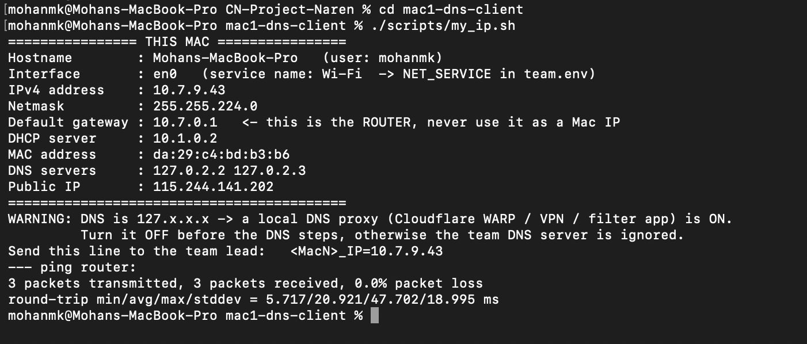
*Mohan: WARNING, a local DNS proxy (WARP) is ON*


*Mohan: same command after turning WARP off*

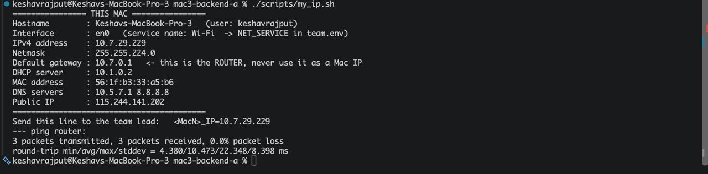
*Keshav: IP 10.7.29.229, router ping OK*

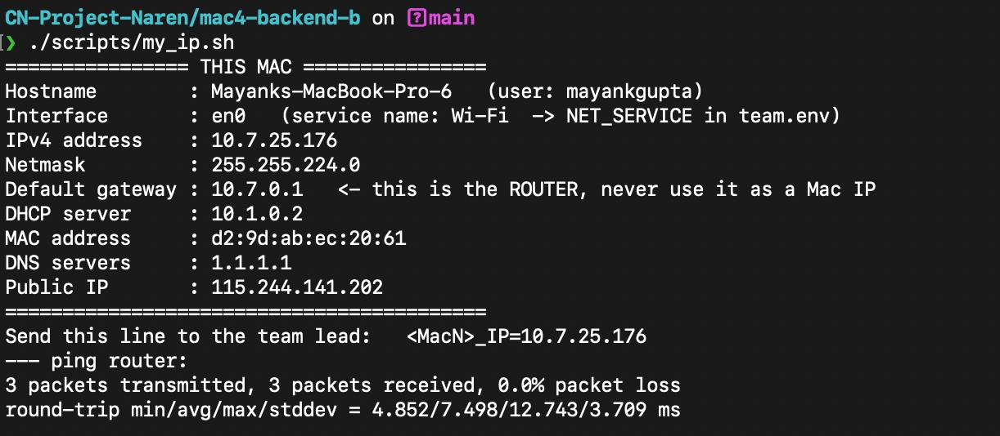
*Mayank: IP 10.7.25.176, router ping OK*

### 2. Our own DNS server  `PASS`

**Owner:** Mohan (Mac 1)

**What we did:** dnsmasq on Mac 1 answers app.team1.test and api.team1.test with the edge's IP. This is our own mini 'Route 53'.

**Commands:**
```bash
./scripts/setup_dnsmasq.sh primary
```

**What the evidence shows:**
- dnsmasq: syntax check OK, started, listening on UDP 10.7.9.43:53 and 127.0.0.1:53.
- Self-test: dig app.team1.test @10.7.9.43 returns A record 10.7.7.27 (the edge).

**Why it works:** DNS only turns a name into an IP. It never connects to anything. Clients then open TCP and TLS to that IP.

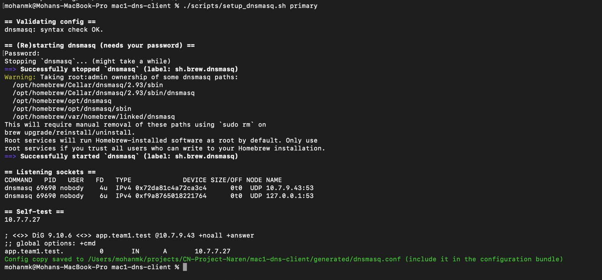
*dnsmasq running and answering 10.7.7.27*

### 3. Edge server and private CA  `PASS`

**Owner:** Narendra (Mac 2)

**What we did:** nginx on Mac 2 terminates HTTPS on port 8443 and load-balances to the two backends. A small server hands out the team CA certificate.

**Commands:**
```bash
./scripts/configure_nginx.sh
./scripts/serve_ca.sh
```

**What the evidence shows:**
- nginx -t successful, nginx listening on *:8443.
- serve_ca.sh served http://10.7.7.27:8000/ca.crt; the access lines show all three teammates downloaded it (10.7.9.43, 10.7.25.176, 10.7.29.229).

**Why it works:** The certificate contains names (SAN) not IPs, so it stays valid even when DHCP changes an IP. Only the public CA is served, private keys never leave Mac 2.


*nginx started and CA server running*

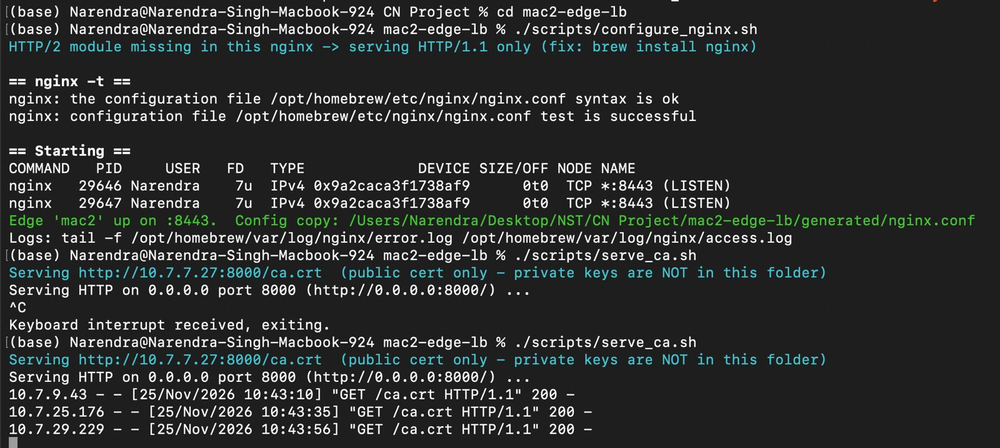
*Three downloads of ca.crt from the three teammates*

### 4. Clients trust the CA and use our DNS  `PASS`

**Owner:** Mohan, Keshav, Mayank

**What we did:** Each client downloads the team CA, installs it as trusted and points its resolver to Mac 1.

**Commands:**
```bash
./scripts/trust_ca.sh && ./scripts/set_dns.sh primary
```

**What the evidence shows:**
- All three print the SAME fingerprint sha256 62:F0:8C:C0:78:C5:16:67:...:2B:31:D9, so everyone trusts the same CA.
- networksetup now lists nameserver 10.7.9.43 on every client. Mayank's old manual DNS (1.1.1.1) and Keshav's empty setting were saved first and can be restored with set_dns.sh restore.

**Why it works:** This meets the 'at least two clients resolve through our DNS' requirement (we have three). It is also why curl works without -k.

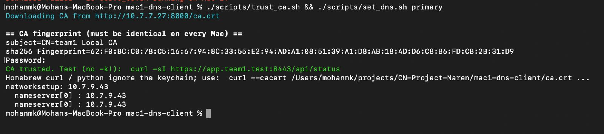
*Mohan*

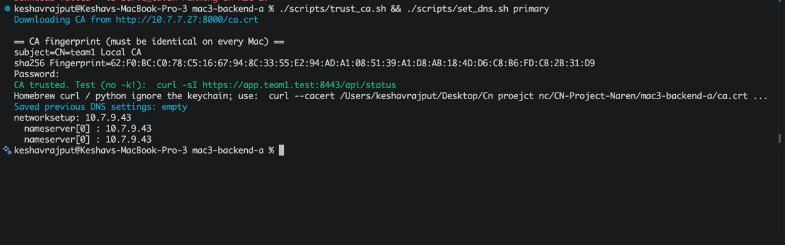
*Keshav*


*Mayank*

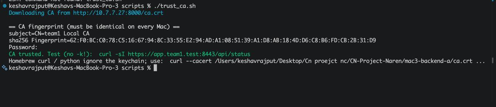
*Keshav, second run (Wi-Fi reconnect)*

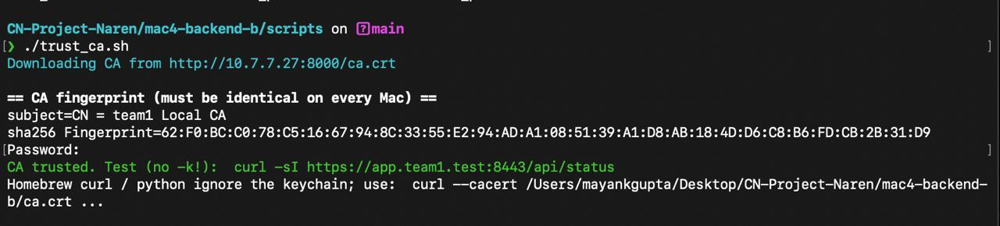
*Mayank, second run*

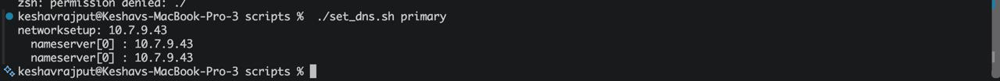
*Keshav set_dns primary*

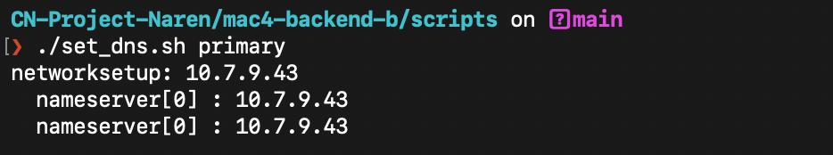
*Mayank set_dns primary*

### 5. Layer-by-layer check: diagnose.sh  `PASS`

**Owner:** Mohan

**What we did:** One script checks IP, DNS, TCP, TLS, HTTP and the backends in that order. The first FAIL is the real problem.

**Commands:**
```bash
./scripts/diagnose.sh
```

**What the evidence shows:**
- First run: everything PASS except TLS: 'Verify return code: 21 (unable to verify the first certificate)'.
- But the HTTP check right below it returned 200 without -k, so the certificate really was trusted. The script was wrong, not the setup.
- Cause: the Mac's built-in openssl (LibreSSL) does not read the macOS keychain where trust_ca.sh put the CA. Fix: give openssl the CA file with -CAfile.
- After the fix every layer is PASS, including 'certificate verifies'.

**Why it works:** A great viva story: a false alarm found by reading the layers in order, and a fix that took one line.

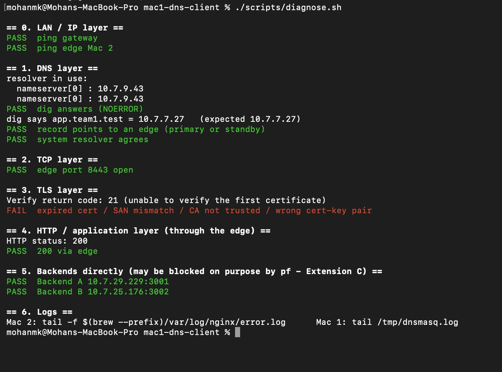
*Before: false FAIL at the TLS layer*

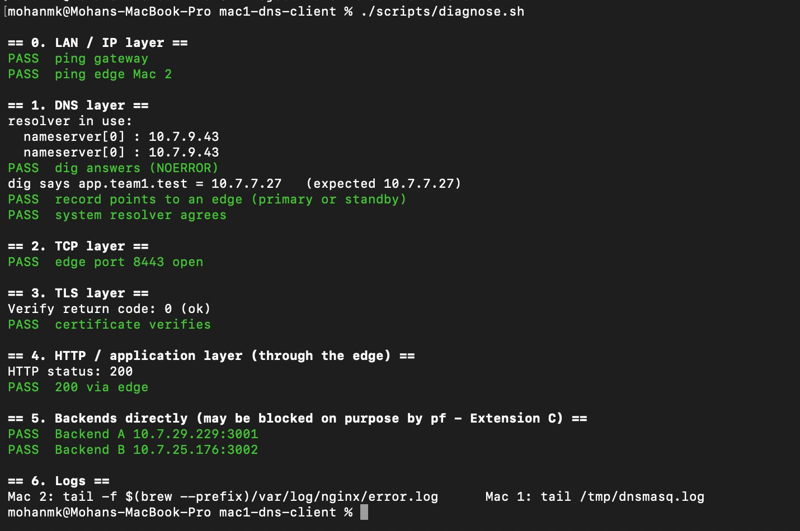
*After the fix: all layers PASS*

### 6. Load balancing  `PASS`

**Owner:** Mohan

**What we did:** Six HTTPS requests to https://app.team1.test:8443/api/status without -k. The X-Backend header tells which backend answered.

**Commands:**
```bash
./scripts/demo_lb.sh
```

**What the evidence shows:**
- The answers alternate between Backend A and Backend B (round-robin), every response is 200 and X-Edge is mac2.
- The client never sees a backend IP, only the edge.

**Why it works:** This was the Phase 1 gate. Round-robin is nginx's default strategy.


*First run*


*Run from the scripts folder*

### 7. TLS proof  `PASS`

**Owner:** Mohan

**What we did:** Shows exactly how the secure connection is built and that the certificate is verified.

**Commands:**
```bash
./scripts/demo_tls.sh
```

**What the evidence shows:**
- TLS 1.3 with TLS_AES_256_GCM_SHA384, subject CN=app.team1.test, issuer CN=team1 Local CA, 'SSL certificate verify ok', 'Verify return code: 0 (ok)'.
- Forcing TLS 1.2 shows the full handshake (Certificate, Server Key Exchange, Finished), which is what Wireshark can display.

**Why it works:** Chain of trust: client trusts CA, CA signed the edge certificate, name matches the SAN. TLS ends at nginx; edge to backend is plain HTTP inside the LAN.


*demo_tls.sh output*


## 4. Phase 2: Harden and recover

### Ext A: Backup DNS  `PASS`

**Owner:** Keshav + Mohan

**What we did:** A second dnsmasq on Mac 3 gives the same answers. Mohan's Mac lists both DNS servers. We stop the primary and the site must still open.

**Commands:**
```bash
Keshav: ./scripts/setup_dnsmasq.sh backup
Mohan: ./scripts/set_dns.sh both
Mohan: sudo brew services stop dnsmasq  (primary down), then dig and curl
```

**What the evidence shows:**
- Both servers answer 10.7.7.27 (EA0).
- Primary down: 'connection timed out; no servers could be reached'. Backup still answers 10.7.7.27.
- The HTTPS request still returned 200. It took 2.552 s, about the 2 s DNS timeout plus the request.

**Why it works:** The resolver list is tried in order: when the first server does not answer, the Mac asks the next one. Failover works but costs one timeout.


*Keshav: backup DNS listening on 10.7.29.229:53 and answering*


*Mohan: primary dead, backup answers, curl still 200*

Raw logs: `mac1-dns-client/evidence/EA0-both-answer.txt`, `mac1-dns-client/evidence/EA2-failover.txt`, `mac3-backend-a/evidence/EA1-backup-dns.txt`

### Ext B: TTL and caching  `PASS`

**Owner:** Mohan (+ Keshav)

**What we did:** With TTL=30 we change the DNS record to another IP while a script watches two views: dig straight to the server (always fresh) and the Mac's own resolver cache.

**Commands:**
```bash
TTL=30 ./scripts/setup_dnsmasq.sh primary
./scripts/demo_ttl.sh  (recording)
APP_IP=10.7.25.176 TTL=30 ./scripts/setup_dnsmasq.sh primary  (change record)
flush cache
```

**What the evidence shows:**
- 11:05:51: dig already shows the new IP 10.7.25.176.
- The system resolver kept the OLD IP 10.7.7.27 until 11:06:22, more than 30 s.
- At 11:06:27 it switched: this is right after the scheduled cache flush. (We cannot separate natural TTL expiry from the flush here, but the old answer clearly survived the change.)

**Why it works:** A cached answer can outlive a record change by up to the TTL. For a planned migration you lower the TTL first. TTL is the price of caching.


*Mohan: timeline of dig (fresh) versus system resolver (cached)*

Raw logs: `mac1-dns-client/evidence/EB-ttl-timeline.txt`

### Ext C: Service isolation with pf (firewall)  `RE-RUN`

**Owner:** Keshav, Mayank, Narendra, Mohan

**What we did:** The backends' ports should only accept connections from the edge (Mac 2). Direct access from a client (Mac 1) must time out, but the site through the edge must still work.

**Commands:**
```bash
Keshav: ./scripts/isolate_pf.sh 3001
Mayank: ./scripts/isolate_pf.sh 3002
Narendra and Mohan: test
Both: ./scripts/rollback_pf.sh
```

**What the evidence shows:**
- DONE: the rules are active on both backends: 'pass in quick ... from 10.7.7.27 to any port 3001/3002' followed by 'block drop in quick ... port 3001/3002'.
- DONE: rollback_pf.sh printed 'rollback OK (rules identical to before)' on both Macs, so the firewall was restored.
- NOT VALID YET, edge test: Narendra's curl failed after 2 ms ('Couldn't connect'). The screenshot shows why: macOS asked 'Allow iTerm to find devices on local networks?' and blocked LAN traffic until allowed.
- NOT VALID YET, client test: Mohan's direct curl to both backends returned 200, so pf was not active at the moment he ran it (the stages were run out of order).

**Why it works:** Least privilege: only the component that needs the port gets it. In the cloud this is a security group. Caveat: source-IP rules can be spoofed on a shared LAN, so this is a concept demo.

> **Re-run needed:** Allow the terminal in System Settings > Privacy & Security > Local Network. Then everybody: git pull and run ./scripts/phase2.sh 4. Order: Keshav and Mayank turn pf ON first, then Narendra (expect 200), then Mohan (expect timeout and edge still 200). The new script warns Mohan if pf is not active.


*Keshav: pf rules on port 3001*


*Mayank: pf rules on port 3002*

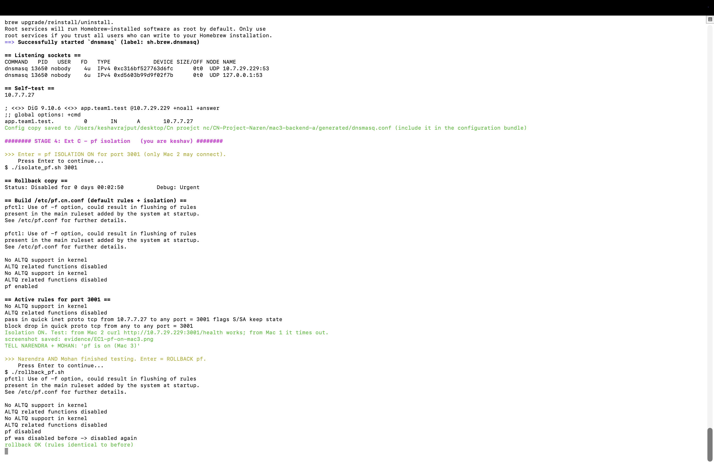
*Keshav: rollback OK*

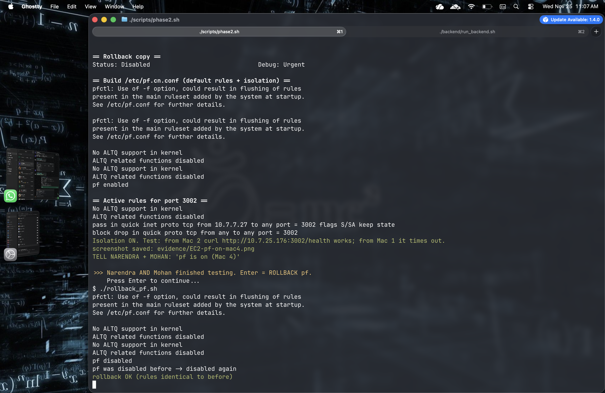
*Mayank: rollback OK*


*Narendra: edge test blocked by the macOS Local Network prompt (to redo)*

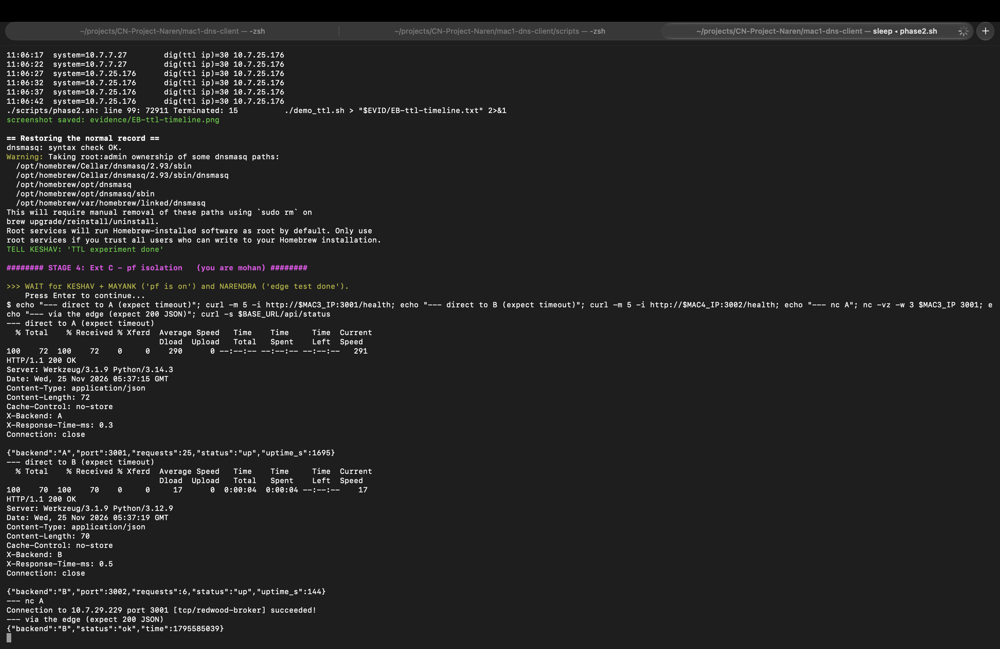
*Mohan: direct access still worked, pf was not on yet (to redo)*

### Ext D: High availability (failover)  `RE-RUN`

**Owner:** Keshav + Mohan + Narendra

**What we did:** Stop Backend A: every answer must come from B and users must notice nothing. Start A again and the A/B alternation returns.

**Commands:**
```bash
Keshav stops Backend A
Mohan: ./scripts/demo_lb.sh
Keshav restarts A, wait 15 s
Mohan: ./scripts/demo_lb.sh
Narendra: tail the nginx access log
```

**What the evidence shows:**
- The stop did not work: Keshav's check still shows 'Python ... TCP *:3001 (LISTEN)'. The script used pkill with 'python', but macOS names the process 'Python', so nothing was killed.
- So Mohan's run still alternates A,B,A,B and is not a failover proof.
- Useful proof already in the log: the lines 'backend=10.7.25.176:3002, 10.7.29.229:3001 ... rt=2.123' (10:59:56) and 'rt=1.029' (11:04:22) show nginx tried :3002 first, failed within its 2 s connect timeout, and automatically served the request from :3001. That is proxy_next_upstream working.

**Why it works:** Passive health checks: after max_fails=2 errors nginx skips a server for fail_timeout=10 s and retries the request on the next one. The single nginx edge is still the point of failure (Ext E).

> **Re-run needed:** The script is fixed (it now stops the process by port). git pull and run ./scripts/phase2.sh 2 on Keshav, Mohan and Narendra. Expect: during the stop all six answers are B; after the restart A/B again.

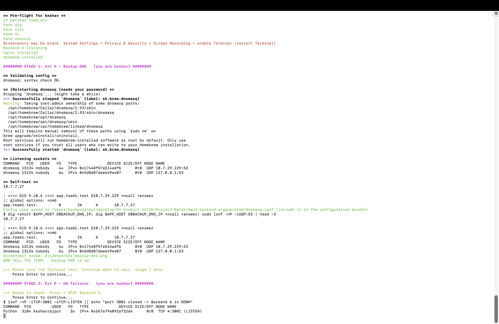
*Keshav: port 3001 still LISTEN, A was not stopped (to redo)*


*Mohan: run during the failed stop*

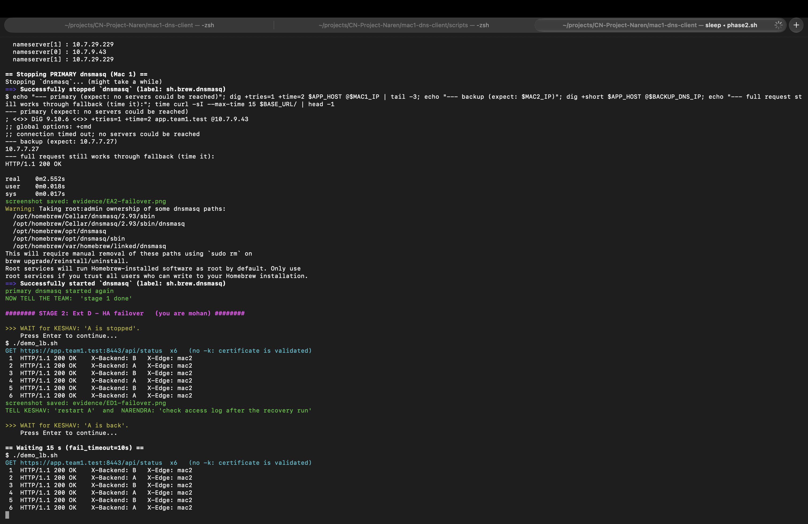
*Mohan: recovery run*


*Narendra: access log, note the two-upstream retry lines*

Raw logs: `mac2-edge-lb/evidence/ED3-access-log.txt`

### Ext E: Standby edge and DNS cutover  `PASS`

**Owner:** Keshav + Mohan + Narendra

**What we did:** A second nginx on Mac 3 (the standby) uses the same certificate. We then change the DNS record from Mac 2 to Mac 3 and watch the traffic move.

**Commands:**
```bash
Narendra: ./scripts/serve_certs.sh  (hands the certificate and key to Keshav only)
Keshav: ./scripts/configure_nginx.sh standby
Mohan: record change to 10.7.29.229 while ./scripts/demo_edge.sh runs
```

**What the evidence shows:**
- Standby answered directly: HTTP/2 200, nginx listening on *:8443 on Mac 3 (EE1).
- Timeline: edge=mac2 with ip 10.7.7.27 until 11:08:07; one '?' sample at 11:08:14 (resolver switching); from 11:08:19 edge=standby with ip 10.7.29.229.
- The record was changed at about 11:07:51, so the switch took about 28 s, matching the 30 s TTL. Backends kept alternating A/B behind the standby.
- phase2_check.sh at the end reports 9 ready, 0 not ready, including 'standby sends X-Edge: standby'.

**Why it works:** This removes the single point of failure by hand: the DNS record decides which edge gets users, and the TTL decides how fast they move. The same certificate works because it holds names, not IPs.


*Keshav: standby nginx up on Mac 3*


*Mohan: edge flips from mac2 to standby*

Raw logs: `mac1-dns-client/evidence/EE2-cutover.txt`, `mac3-backend-a/evidence/EE1-standby.txt`

### Ext F: Troubleshooting  `RE-RUN`

**Owner:** Mohan + Narendra

**What we did:** Narendra breaks something (stops nginx) and Mohan finds it with diagnose.sh by reading the layers in order.

**Commands:**
```bash
Mohan: ./scripts/diagnose.sh (healthy)
Narendra: nginx -s stop
Mohan: ./scripts/diagnose.sh (fault)
Narendra restarts nginx
Mohan: ./scripts/diagnose.sh; ./scripts/phase2_check.sh
```

**What the evidence shows:**
- Healthy run: every layer PASS (EF1).
- Narendra's log confirms 'nginx is STOPPED (fault injected)' (EF0), but Mohan's 'fault' run is also all PASS, so he ran it before nginx was stopped. It does not show the fault yet.
- Final check: all PASS and phase2_check says 9 ready, 0 not ready (EF3).

**Why it works:** Expected result of the real test: the first FAIL appears at layer 2 (TCP, edge port 8443 not open) and everything above it fails too. That tells you the edge is down, not DNS and not TLS.

> **Re-run needed:** Narendra runs ./scripts/phase2.sh 6 and stops nginx first and says 'fault injected'; only then Mohan runs his stage 6. The new script warns Mohan if there is no FAIL in the output.

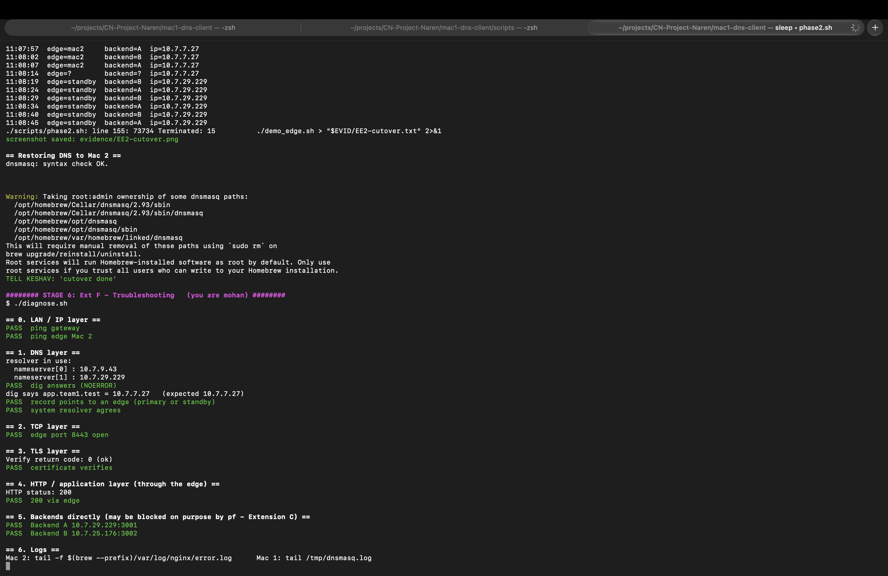
*Healthy*


*Fault run, still all PASS (to redo)*


*Final check: 9 ready, 0 not ready*

Raw logs: `mac2-edge-lb/evidence/EF0-fault.txt`


## 5. Problems we hit and how we fixed them

| Problem | What happened and the fix |
|---|---|
| Campus DHCP changed every IP | Scripts refused to run ('does not have IP'). We ran setup_team.sh with the new IPs, pushed team.env and everyone re-cloned. Lesson: IPs are in one file; certificates use names, so they did not need to be rebuilt. |
| Cloudflare WARP on Mohan's Mac | DNS showed 127.0.2.2, so our DNS server was ignored. The script printed a red warning, WARP was turned off. |
| diagnose.sh showed a false TLS FAIL | LibreSSL's openssl does not use the macOS keychain. Fixed by passing the CA file with -CAfile. |
| macOS Local Network permission | iTerm was not allowed to talk to LAN devices, so curl failed after 2 ms. Fix: System Settings > Privacy & Security > Local Network. |
| Backend A would not stop | pkill -f 'python backend.py' is case sensitive; macOS shows 'Python'. Fixed by stopping whatever listens on port 3001. |
| Stages run out of order | Some tests ran before the fault or the firewall was in place. The scripts now print a warning when the expected condition is missing. |
| Screenshots | Auto-screenshots need Screen Recording permission for the terminal app. The text output (.txt) is saved next to every screenshot as a backup. |

## 6. Still to do before submission

- [ ] Phase 1 Task F (caching): ./scripts/demo_cache.sh, Cache-Control, ETag and the 304 answer.
- [ ] Phase 1 Task G (Wireshark): phase1.pcapng with the DNS, TCP handshake, TLS handshake and encrypted data views.
- [ ] Phase 1 five failure demos: ./scripts/failures.sh 1 to 5, one screenshot each with one sentence of 'why'.
- [ ] Phase 1 Task A ping matrix (check_lan.sh) and the lsof screenshots that show the backends listening on *:3001 and *:3002.
- [ ] Phase 2 re-runs: Ext C tests, Ext D real failover, Ext F real fault (see the amber boxes).
- [ ] Chapter 9 of Docs/CN_Project_Master.pdf: paste the numbers and screenshots from this report.

## 7. Viva: short answers

**Why does DNS not connect to the server?** DNS only maps a name to an IP using UDP port 53. TCP, TLS and HTTP start afterwards, towards that IP.

**What did the backup DNS test show?** With the primary stopped the first query timed out, the resolver used the second server, and the page still loaded in 2.55 s.

**What is TTL and what did we measure?** TTL is how long an answer may be cached. After the record change the Mac kept the old IP for 30+ seconds. The cutover to the standby took about 28 s.

**How does the certificate chain work?** The client trusts team1 Local CA, the CA signed the edge certificate, and the name app.team1.test is in its SAN. We proved it with 'Verify return code: 0 (ok)'.

**How does nginx survive a dead backend?** max_fails=2 and fail_timeout=10 s mark it down, proxy_next_upstream retries on the other backend. The log shows a request tried :3002 and was served by :3001 after 2 s.

**What is still a single point of failure?** The one nginx edge. The standby edge plus a DNS change fixes it manually; keepalived/VRRP or a cloud load balancer would make it automatic.

**What does pf do and how is it like the cloud?** It filters packets by source and port. Only Mac 2 may reach the backend ports, like a security group. Source IPs can be spoofed on a LAN, so it is a demo of the idea.

**Why was the first TLS check red but curl green?** curl uses the macOS keychain, the old check used openssl which does not. We pointed openssl at the CA file.

