# CN Project: Final Evidence Report (Phase 1 and Phase 2)

Team 1 · Private Network Service Platform · 25 Nov 2026 · generated from `evidence/build_report.py`. Open `evidence/index.html` for the illustrated version.

## 1. What we built (in one minute)

A client opens `https://app.team1.test:8443`. **Our own DNS** (Mac 1) turns the name into the edge's IP. The **nginx edge** (Mac 2) completes the TCP and TLS handshake with a certificate signed by **our own CA**, then **load-balances** the request to **Backend A** (Mac 3) or **Backend B** (Mac 4). Everything runs on four laptops on one Wi-Fi, no cloud. Phase 2 breaks and hardens it: backup DNS, TTL, firewall isolation, failover, a standby edge, and troubleshooting.

```
Client -> DNS (Mac1, UDP 53) -> nginx edge (Mac2, TCP+TLS 8443) -> Backend A (Mac3 :3001) / Backend B (Mac4 :3002)
```

| Mac | Owner | IP | Role |
|---|---|---|---|
| Mac 1 | Mohan Kumar C R | `10.7.9.43` | DNS server (dnsmasq) + main test client |
| Mac 2 | Narendra Singh (team lead) | `10.7.7.27` | Edge: nginx reverse proxy, load balancer, TLS, private CA |
| Mac 3 | Keshav Rajput | `10.7.29.229` | Backend A :3001 + backup DNS + standby edge |
| Mac 4 | Mayank Gupta | `10.7.25.176` | Backend B :3002 |

## 2. Result at a glance

| Task | Owner | Status |
|---|---|---|
| Network and IP check | All four | **PASS** |
| Our own DNS server | Mohan (Mac 1) | **PASS** |
| Edge server and private CA | Narendra (Mac 2) | **PASS** |
| Clients trust the CA and use our DNS | Mohan, Keshav, Mayank | **PASS** |
| Layer-by-layer check: diagnose.sh | Mohan | **PASS** |
| Load balancing | Mohan | **PASS** |
| TLS proof | Mohan | **PASS** |
| Backends A and B | Keshav (Mac 3), Mayank (Mac 4) | **PASS** |
| Task A: LAN ping matrix | Narendra (run on Mac 2) | **REPRODUCED** |
| Task F: HTTP caching | Narendra (run on Mac 2) | **REPRODUCED** |
| Task G: Wireshark view of one request | Mohan (explained here) | **EXPLAINED** |
| The five required failure demos | Narendra (run on Mac 2) | **3 REPRODUCED, 2 EXPLAINED** |
| Ext A: Backup DNS | Keshav + Mohan | **PASS** |
| Ext B: TTL and caching | Mohan (+ Keshav) | **PASS** |
| Ext C: Service isolation with pf (firewall) | Keshav, Mayank, Narendra, Mohan | **PASS WITH NOTES** |
| Ext D: High availability (failover) | Keshav + Mohan + Narendra | **PASS WITH NOTES** |
| Ext E: Standby edge and DNS cutover | Keshav + Mohan + Narendra | **PASS** |
| Ext F: Troubleshooting | Mohan + Narendra | **PASS WITH NOTES** |

**PASS** = evidence captured and valid. **PASS WITH NOTES** = valid evidence plus one honest note about what a screenshot does or does not show. **REPRODUCED** = captured live on Mac 2 after the lab session. **EXPLAINED** = no capture, the behaviour is explained from other evidence.


## 3. Phase 1: Build and observe

### Network and IP check  `PASS`

**Owner:** All four

**What we did:** Before anything else every Mac proves it is on the same campus Wi-Fi subnet (10.7.0.0/19) and can reach the router.

**Commands:**
```bash
./scripts/my_ip.sh
```

**What the evidence shows:**
- Each Mac prints its IPv4 address, netmask 255.255.224.0, gateway 10.7.0.1 and a router ping with 0% loss.
- The campus DHCP server had changed all four IPs, so the team re-ran setup_team.sh and pushed the new team.env (Mohan 10.7.9.43, Narendra 10.7.7.27, Keshav 10.7.29.229, Mayank 10.7.25.176).
- Mohan's first run shows a red WARNING: DNS 127.0.2.2 means Cloudflare WARP was ON and would ignore our DNS server. He switched it off (second run, DNS no longer 127.x).

**Why it works:** DNS, TCP and TLS only work if the IP layer works. Every script also refuses to run if the Mac's IP is not the one in team.env, which stops silent mistakes.


*Mohan: WARNING, a local DNS proxy (WARP) is ON*

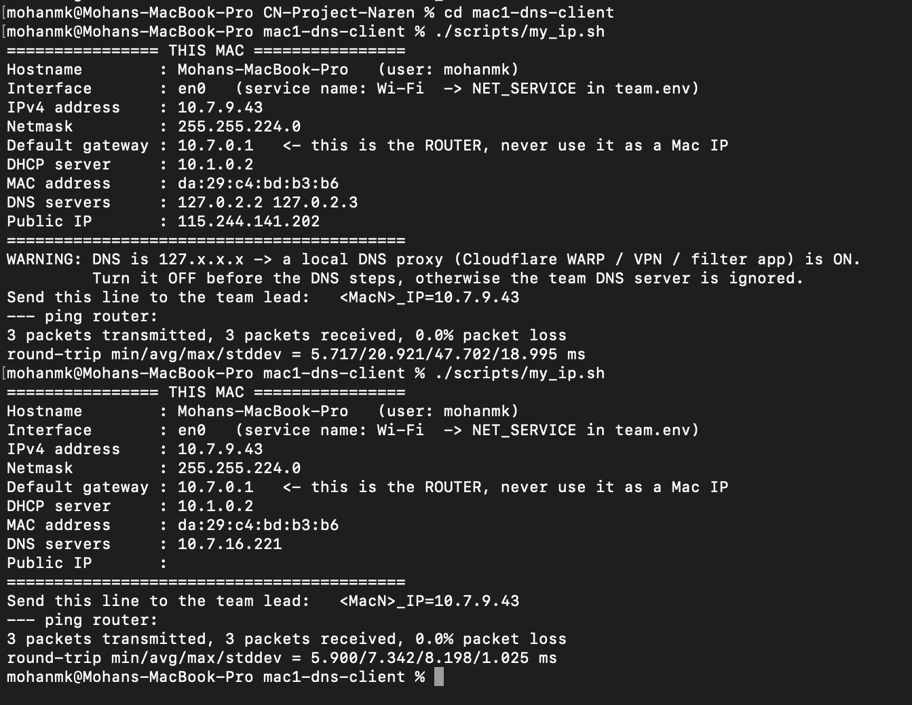
*Mohan: same command after turning WARP off*


*Keshav: IP 10.7.29.229, router ping OK*


*Mayank Gupta: IP 10.7.25.176, router ping OK*

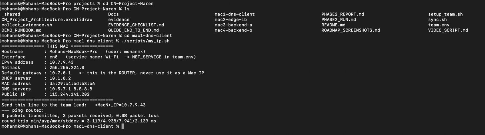
*Mohan: fresh git clone of the repo*

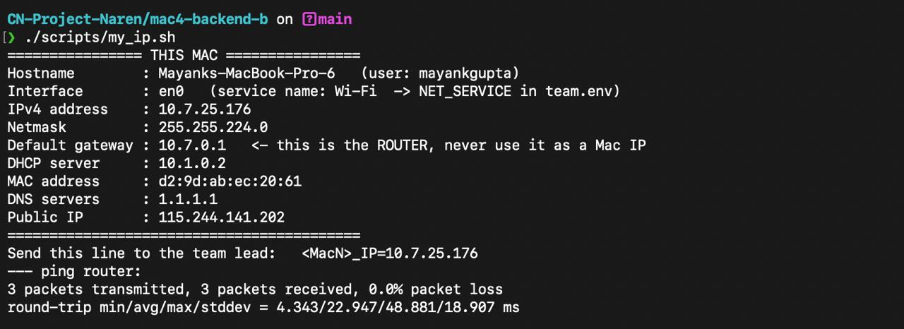
*Mayank: IP check after the fresh clone*

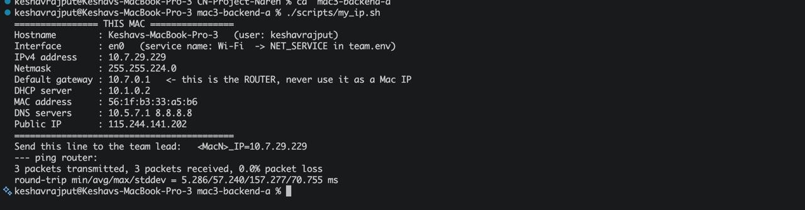
*Keshav: IP check after the fresh clone*

### Our own DNS server  `PASS`

**Owner:** Mohan (Mac 1)

**What we did:** dnsmasq on Mac 1 answers app.team1.test and api.team1.test with the edge's IP. This is our own mini 'Route 53'.

**Commands:**
```bash
./scripts/setup_dnsmasq.sh primary
```

**What the evidence shows:**
- dnsmasq: syntax check OK, started, listening on UDP 10.7.9.43:53 and 127.0.0.1:53.
- Self-test: dig app.team1.test @10.7.9.43 returns A record 10.7.7.27 (the edge).

**Why it works:** DNS only turns a name into an IP. It never connects to anything. Clients then open TCP and TLS to that IP.

**Queried live from Mac 2 against Mohan's dnsmasq (25 Nov 11:36), proving it serves other Macs too**
```text
# captured 2026-11-25 11:36:02 on Mac 2 (10.7.7.27)
$ dig app.team1.test @$MAC1_IP +noall +answer; dig +short api.team1.test @$MAC1_IP

; <<>> DiG 9.10.6 <<>> app.team1.test @10.7.9.43 +noall +answer
;; global options: +cmd
app.team1.test.		0	IN	A	10.7.7.27
10.7.7.27
```


*dnsmasq running and answering 10.7.7.27*

### Edge server and private CA  `PASS`

**Owner:** Narendra (Mac 2)

**What we did:** nginx on Mac 2 terminates HTTPS on port 8443 and load-balances to the two backends. A small server hands out the team CA certificate.

**Commands:**
```bash
./scripts/configure_nginx.sh
./scripts/serve_ca.sh
```

**What the evidence shows:**
- nginx -t successful, nginx listening on *:8443.
- serve_ca.sh served http://10.7.7.27:8000/ca.crt; the access lines show all three teammates downloaded it (10.7.9.43, 10.7.25.176, 10.7.29.229).

**Why it works:** The certificate contains names (SAN) not IPs, so it stays valid even when DHCP changes an IP. Only the public CA is served, private keys never leave Mac 2.

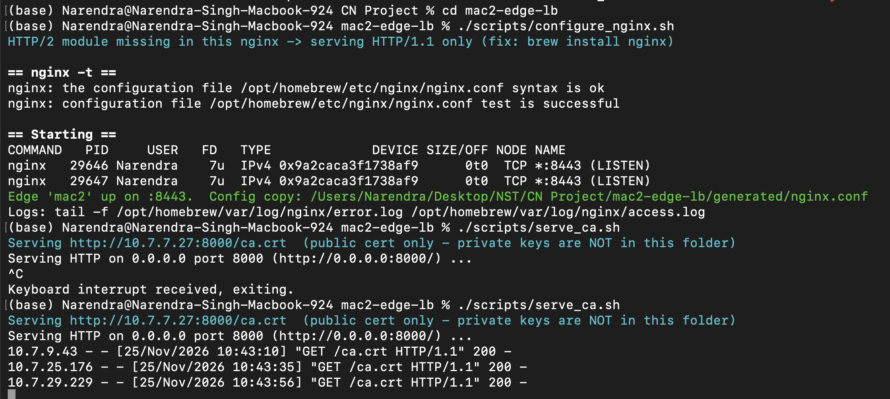
*nginx started and CA server running*


*Three downloads of ca.crt from the three teammates*

### Clients trust the CA and use our DNS  `PASS`

**Owner:** Mohan, Keshav, Mayank

**What we did:** Each client downloads the team CA, installs it as trusted and points its resolver to Mac 1.

**Commands:**
```bash
./scripts/trust_ca.sh && ./scripts/set_dns.sh primary
```

**What the evidence shows:**
- All three print the SAME fingerprint sha256 62:F0:8C:C0:78:C5:16:67:...:2B:31:D9, so everyone trusts the same CA.
- networksetup now lists nameserver 10.7.9.43 on every client. Mayank's old manual DNS (1.1.1.1) and Keshav's empty setting were saved first and can be restored with set_dns.sh restore.

**Why it works:** This meets the 'at least two clients resolve through our DNS' requirement (we have three). It is also why curl works without -k.


*Mohan*


*Keshav*

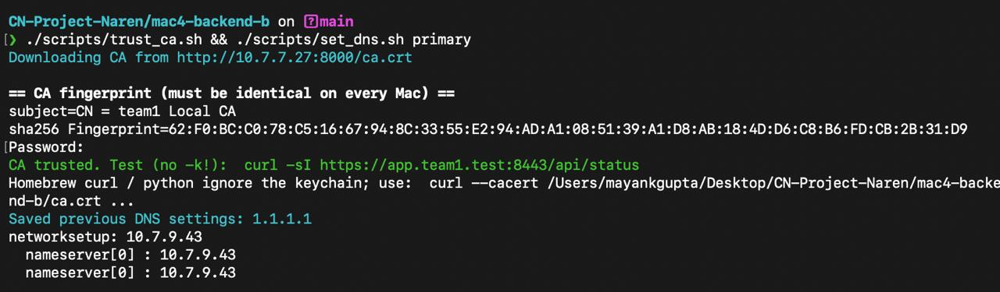
*Mayank*


*Keshav, second run (Wi-Fi reconnect)*


*Mayank, second run*


*Keshav set_dns primary*


*Mayank set_dns primary*

### Layer-by-layer check: diagnose.sh  `PASS`

**Owner:** Mohan

**What we did:** One script checks IP, DNS, TCP, TLS, HTTP and the backends in that order. The first FAIL is the real problem.

**Commands:**
```bash
./scripts/diagnose.sh
```

**What the evidence shows:**
- First run: everything PASS except TLS: 'Verify return code: 21 (unable to verify the first certificate)'.
- But the HTTP check right below it returned 200 without -k, so the certificate really was trusted. The script was wrong, not the setup.
- Cause: the Mac's built-in openssl (LibreSSL) does not read the macOS keychain where trust_ca.sh put the CA. Fix: give openssl the CA file with -CAfile.
- After the fix every layer is PASS, including 'certificate verifies'.

**Why it works:** A great viva story: a false alarm found by reading the layers in order, and a fix that took one line.


*Before: false FAIL at the TLS layer*


*After the fix: all layers PASS*

### Load balancing  `PASS`

**Owner:** Mohan

**What we did:** Six HTTPS requests to https://app.team1.test:8443/api/status without -k. The X-Backend header tells which backend answered.

**Commands:**
```bash
./scripts/demo_lb.sh
```

**What the evidence shows:**
- The answers alternate between Backend A and Backend B (round-robin), every response is 200 and X-Edge is mac2.
- The client never sees a backend IP, only the edge.

**Why it works:** This was the Phase 1 gate. Round-robin is nginx's default strategy.

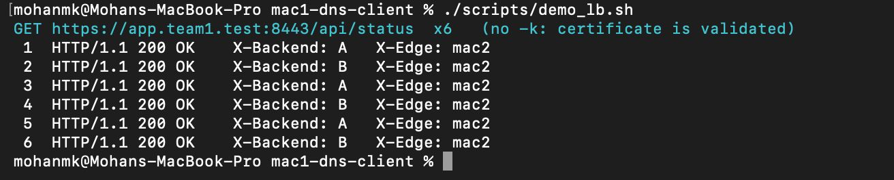
*First run*

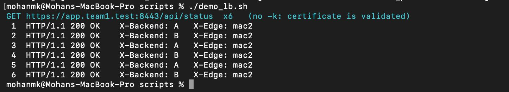
*Run from the scripts folder*

### TLS proof  `PASS`

**Owner:** Mohan

**What we did:** Shows exactly how the secure connection is built and that the certificate is verified.

**Commands:**
```bash
./scripts/demo_tls.sh
```

**What the evidence shows:**
- TLS 1.3 with TLS_AES_256_GCM_SHA384, subject CN=app.team1.test, issuer CN=team1 Local CA, 'SSL certificate verify ok', 'Verify return code: 0 (ok)'.
- Forcing TLS 1.2 shows the full handshake (Certificate, Server Key Exchange, Finished), which is what Wireshark can display.

**Why it works:** Chain of trust: client trusts CA, CA signed the edge certificate, name matches the SAN. TLS ends at nginx; edge to backend is plain HTTP inside the LAN.

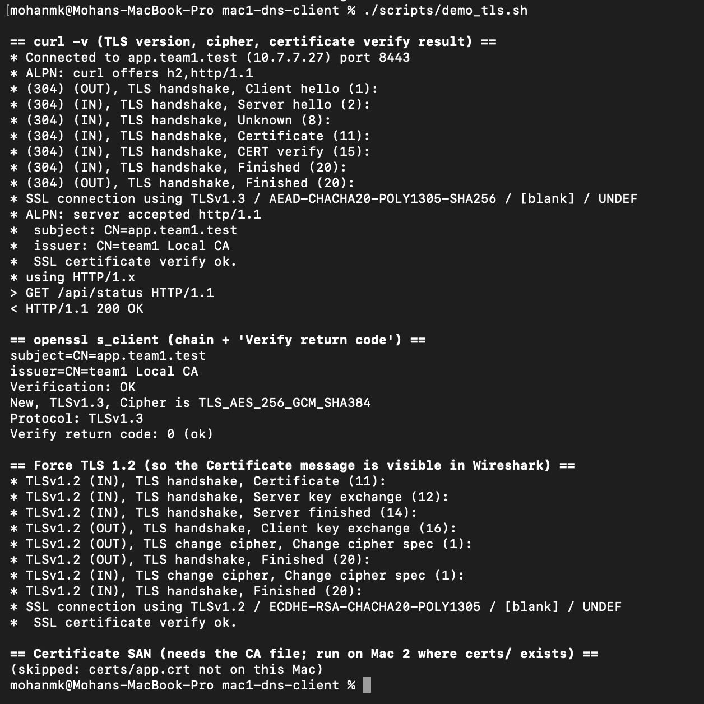
*demo_tls.sh output*

### Backends A and B  `PASS`

**Owner:** Keshav (Mac 3), Mayank (Mac 4)

**What we did:** Two copies of the same small Flask app, one per Mac. Each answers with its own X-Backend header and listens on all interfaces (0.0.0.0), not only on localhost.

**Commands:**
```bash
./backend/run_backend.sh   (Mac 3: port 3001, Mac 4: port 3002)
```

**What the evidence shows:**
- From a different Mac (Mohan's) both backends answered directly: Backend A on 10.7.29.229:3001 and Backend B on 10.7.25.176:3002, each with HTTP 200 and its own X-Backend header and port in the JSON.
- nc to 10.7.29.229 port 3001 succeeded, so the socket is reachable from the LAN. The same JSON also shows request counters and uptime (Keshav's logging).
- The standby edge later answered with x-backend: A as well (Ext E), so the backends are shared by both edges.

**Why it works:** Binding to 0.0.0.0 makes the port reachable from other Macs. Different ports (3001, 3002) let two backends coexist and be told apart. Identical bodies give identical ETags on A and B.

**Mohan's Mac reaching both backends directly (taken before pf was switched on)**
```text
HTTP/1.1 200 OK
X-Backend: A
{"backend":"A","port":3001,"requests":25,"status":"up","uptime_s":1695}
HTTP/1.1 200 OK
X-Backend: B
{"backend":"B","port":3002,"requests":6,"status":"up","uptime_s":144}
Connection to 10.7.29.229 port 3001 [tcp/redwood-broker] succeeded!
{"backend":"B","status":"ok","time":1795585039}
```

### Task A: LAN ping matrix  `REPRODUCED`

**Owner:** Narendra (run on Mac 2)

**What we did:** check_lan.sh collects this Mac's network facts and pings every Mac of the team.

**Commands:**
```bash
./scripts/check_lan.sh
```

**What the evidence shows:**
- Mac 2 on en0: 10.7.7.27, netmask 255.255.224.0, gateway 10.7.0.1.
- All four Macs answer ping: OK for 10.7.9.43, 10.7.7.27, 10.7.29.229 and 10.7.25.176.

**Why it works:** The IP layer must work before DNS, TCP or TLS can. A failed ping usually means a different Wi-Fi, a VPN or router client isolation.

**Captured live on Mac 2 on 25 Nov 2026 11:35**
```text
# captured 2026-11-25 11:35:58 on Mac 2 (10.7.7.27)
$ ./check_lan.sh

== This Mac (copy into the IP inventory table) ==
Interface : en0
IPv4      : 10.7.7.27
Netmask   : 255.255.224.0  (0xffffe000)
Gateway   : 10.7.0.1
MAC addr  : 9e:ed:71:95:bb:39
Hostname  : Narendra-Singh-Macbook-924
DNS in use: There aren't any DNS Servers set on Wi-Fi. 

== Ping matrix from this Mac ==
OK    Mac1 10.7.9.43
OK    Mac2 10.7.7.27
OK    Mac3 10.7.29.229
OK    Mac4 10.7.25.176

If a ping fails: same Wi-Fi? VPN off? Router 'client/AP isolation' off? (use a phone hotspot)
```

### Task F: HTTP caching  `REPRODUCED`

**Owner:** Narendra (run on Mac 2)

**What we did:** The catalog endpoint is cacheable (Cache-Control and an ETag). A second request with If-None-Match must return 304 Not Modified with no body. The status endpoint must never be cached.

**Commands:**
```bash
curl -si http://127.0.0.1:3901/api/catalog
curl -si -H 'If-None-Match: <etag>' http://127.0.0.1:3901/api/catalog
curl -sI http://127.0.0.1:3901/api/status
```

**What the evidence shows:**
- First request: 200 OK with ETag "0ee15ab3a9bc1a9c" and Cache-Control: max-age=60.
- Conditional request with that ETag: 304 NOT MODIFIED, no body.
- /api/status: Cache-Control: no-store.

**Why it works:** max-age=60 lets the browser reuse the answer for 60 s with no request at all. After that the ETag lets the server say 'unchanged' with a tiny 304. Backends A and B return the same ETag, so a 304 works whichever one answers.

> **Note:** This was reproduced after the lab session, directly against backend.py. Through the nginx edge the headers are identical because nginx passes them on unchanged.

**Captured on Mac 2 with the same backend.py the team ran, started locally, because the lab backends were switched off when this section was written**
```text
# captured 2026-11-25 11:36:14 on Mac 2 (10.7.7.27)
$ echo "--- 1) first request: full 200 with Cache-Control + ETag"; curl -si http://127.0.0.1:3901/api/catalog | sed -n "1,12p"; E=$(curl -sI http://127.0.0.1:3901/api/catalog | tr -d "\r" | awk -F": " "tolower(\$1)==\"etag\"{print \$2}"); echo; echo "--- 2) conditional request with If-None-Match: $E  (expect 304, no body)"; curl -si -H "If-None-Match: $E" http://127.0.0.1:3901/api/catalog | sed -n "1,8p"; echo; echo "--- 3) dynamic endpoint must NOT be cached"; curl -sI http://127.0.0.1:3901/api/status | grep -i -E "HTTP/|cache-control"
--- 1) first request: full 200 with Cache-Control + ETag
HTTP/1.1 200 OK
Server: Werkzeug/3.1.8 Python/3.13.5
Date: Wed, 25 Nov 2026 06:06:14 GMT
Content-Type: application/json
Content-Length: 74
ETag: "0ee15ab3a9bc1a9c"
Cache-Control: max-age=60
Date: Wed, 25 Nov 2026 06:06:14 GMT
X-Backend: A
X-Response-Time-ms: 1.3
Connection: close


--- 2) conditional request with If-None-Match: "0ee15ab3a9bc1a9c"  (expect 304, no body)
HTTP/1.1 304 NOT MODIFIED
Server: Werkzeug/3.1.8 Python/3.13.5
Date: Wed, 25 Nov 2026 06:06:14 GMT
ETag: "0ee15ab3a9bc1a9c"
Cache-Control: max-age=60
Date: Wed, 25 Nov 2026 06:06:14 GMT
X-Backend: A
X-Response-Time-ms: 0.3

--- 3) dynamic endpoint must NOT be cached
HTTP/1.1 200 OK
Cache-Control: no-store
```

### Task G: Wireshark view of one request  `EXPLAINED`

**Owner:** Mohan (explained here)

**What we did:** What a packet capture of one HTTPS request shows, in order, and which of our evidence matches each part. The capture file itself (phase1.pcapng) was not recorded.

**Commands:**
```bash
display filters: dns | tcp.flags.syn==1 && tcp.port==8443 | tls.handshake | tls.record.content_type==23
```

**What the evidence shows:**
- dns: a query for app.team1.test from the client to UDP port 53 and the answer 10.7.7.27 with its TTL. Matching evidence: the dig outputs (EA0, B8) and the TTL timeline (EB).
- tcp.flags.syn==1: SYN, SYN-ACK, ACK between a random client port and port 8443 on the edge. Matching evidence: nc to 10.7.7.27 port 8443 'succeeded' (X1).
- tls.handshake: ClientHello with SNI app.team1.test, ServerHello, Certificate (visible in TLS 1.2), Finished. Matching evidence: the demo_tls screenshot lists exactly these messages for TLS 1.2 and the TLS 1.3 summary.
- tls.record.content_type==23: encrypted application data, so the HTTP request and the JSON answer are unreadable on the wire.

**Why it works:** Each layer has its own visible signature: UDP/53 for DNS, a three-packet TCP handshake, a TLS handshake and then opaque data. In TLS 1.3 the certificate is encrypted, which is why we also forced TLS 1.2 to show it.


*The TLS handshake messages as printed by demo_tls.sh*

### The five required failure demos  `REPRODUCED`

**Owner:** Narendra (run on Mac 2)

**What we did:** Five ways the system can fail, each shown at a different layer. Failures 1, 4 and 5 were reproduced live on Mac 2 on 25 Nov 11:36; 2 and 3 are explained with the evidence we already have.

**Commands:**
```bash
Failure 1: dig +time=2 +tries=1 app.team1.test @<a DNS server that does not exist>
Failure 4: curl -si https://app.team1.test:8443/api/status   (both backends down)
Failure 5: curl https://app.team1.test:9999/   and   nc -vz <edge> 9999
```

**What the evidence shows:**
- Failure 1, wrong client DNS (live): the dig to 10.7.9.250 prints 'connection timed out; no servers could be reached', yet ping to Mac 1 works and a TCP connect to the edge on 8443 succeeds. So DNS and IP are different layers.
- Failure 2, DNS record points to the wrong IP (explained): the name resolves but leads to the wrong machine. Our TTL timeline (EB) shows this exactly: the record was changed to 10.7.25.176 and the resolver served it without any error.
- Failure 3, one backend down (explained): nginx skips the dead backend and the other answers. Evidence: the access-log lines with two upstreams in Ext D.
- Failure 4, both backends down (live): DNS answers 10.7.7.27, TLS verifies with 'Verify return code: 0 (ok)', then HTTP returns '502 Bad Gateway' with X-Edge: mac2. The nginx error log shows 'connect() failed (61: Connection refused) while connecting to upstream' for both 10.7.25.176:3002 and 10.7.29.229:3001.
- Failure 5, wrong port (live): host reachable but 'Connection refused' on port 9999.

**Why it works:** Reading the symptom tells you the layer: timeout on DNS = resolver, 'refused' = host up but port closed, 502 with a good TLS handshake = the edge is fine and the backends are the problem.

**Failure 1: wrong DNS server**
```text
# captured 2026-11-25 11:36:06 on Mac 2 (10.7.7.27)
$ echo "--- dig to a DNS server that does not exist (expect: timed out)"; dig +time=2 +tries=1 $APP_HOST @${MAC1_IP%.*}.250 | tail -3; echo "--- the real DNS server and the edge are still reachable by IP"; ping -c 2 $MAC1_IP | tail -2; nc -vz -w 3 $MAC2_IP $HTTPS_PORT
--- dig to a DNS server that does not exist (expect: timed out)
; <<>> DiG 9.10.6 <<>> +time=2 +tries=1 app.team1.test @10.7.9.250
;; global options: +cmd
;; connection timed out; no servers could be reached
--- the real DNS server and the edge are still reachable by IP
2 packets transmitted, 2 packets received, 0.0% packet loss
round-trip min/avg/max/stddev = 49.798/71.303/92.807/21.504 ms
Connection to 10.7.7.27 port 8443 [tcp/pcsync-https] succeeded!
```

**Failure 4: both backends down**
```text
# captured 2026-11-25 11:36:10 on Mac 2 (10.7.7.27)
$ echo "--- DNS ok:"; dig +short $APP_HOST @$MAC1_IP; echo "--- TLS ok:"; openssl s_client -connect $IP:$HTTPS_PORT -servername $APP_HOST -CAfile "$CA" </dev/null 2>/dev/null | grep -E "subject=|issuer=|Verify return code"; echo "--- HTTP through the edge (both backends are down):"; curl -si --max-time 15 --cacert "$CA" --resolve $APP_HOST:$HTTPS_PORT:$IP $BASE_URL/api/status | head -8; echo "--- nginx error log:"; tail -n 3 "$(brew --prefix)/var/log/nginx/error.log"
--- DNS ok:
10.7.7.27
--- TLS ok:
subject=CN = app.team1.test
issuer=CN = team1 Local CA
Verify return code: 0 (ok)
--- HTTP through the edge (both backends are down):
HTTP/1.1 502 Bad Gateway
Server: nginx/1.27.0
Date: Wed, 25 Nov 2026 06:06:12 GMT
Content-Type: text/html
Content-Length: 157
Connection: keep-alive
X-Edge: mac2

--- nginx error log:
2026/11/25 11:36:03 [emerg] 37471#0: still could not bind()
2026/11/25 11:36:11 [error] 33370#0: *19 kevent() reported that connect() failed (61: Connection refused) while connecting to upstream, client: 10.7.7.27, server: app.team1.test, request: "GET /api/status HTTP/1.1", upstream: "http://10.7.25.176:3002/api/status", host: "app.team1.test:8443"
2026/11/25 11:36:12 [error] 33370#0: *19 kevent() reported that connect() failed (61: Connection refused) while connecting to upstream, client: 10.7.7.27, server: app.team1.test, request: "GET /api/status HTTP/1.1", upstream: "http://10.7.29.229:3001/api/status", host: "app.team1.test:8443"
```

**Failure 5: wrong port**
```text
# captured 2026-11-25 11:36:12 on Mac 2 (10.7.7.27)
$ curl -sv --max-time 6 --cacert "$CA" --resolve $APP_HOST:9999:$IP https://$APP_HOST:9999/ 2>&1 | grep -E "Trying|refused|timed out|Failed"; nc -vz -w 3 $IP 9999
*   Trying 10.7.7.27:9999...
* connect to 10.7.7.27 port 9999 from 10.7.7.27 port 53486 failed: Connection refused
* Failed to connect to app.team1.test port 9999 after 0 ms: Couldn't connect to server
nc: connectx to 10.7.7.27 port 9999 (tcp) failed: Connection refused
```


## 4. Phase 2: Harden and recover

### Ext A: Backup DNS  `PASS`

**Owner:** Keshav + Mohan

**What we did:** A second dnsmasq on Mac 3 gives the same answers. Mohan's Mac lists both DNS servers. We stop the primary and the site must still open.

**Commands:**
```bash
Keshav: ./scripts/setup_dnsmasq.sh backup
Mohan: ./scripts/set_dns.sh both
Mohan: sudo brew services stop dnsmasq  (primary down), then dig and curl
```

**What the evidence shows:**
- Both servers answer 10.7.7.27 (EA0).
- Primary down: 'connection timed out; no servers could be reached'. Backup still answers 10.7.7.27.
- The HTTPS request still returned 200. It took 2.552 s, about the 2 s DNS timeout plus the request.

**Why it works:** The resolver list is tried in order: when the first server does not answer, the Mac asks the next one. Failover works but costs one timeout.

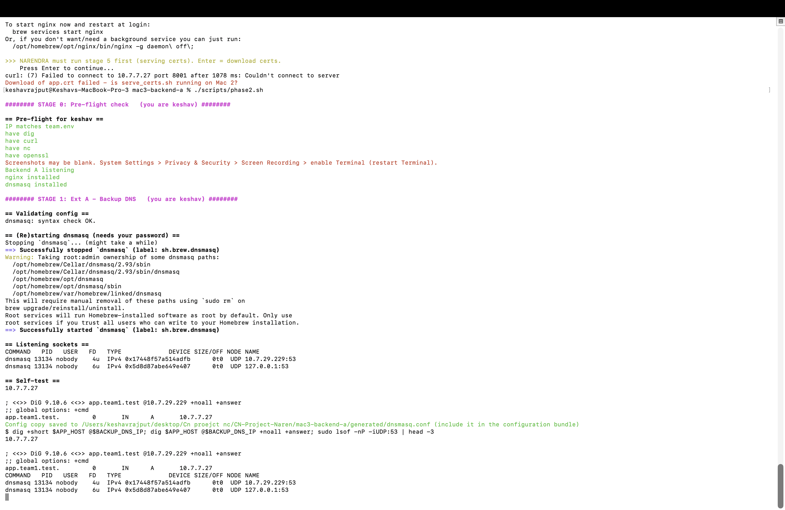
*Keshav: backup DNS listening on 10.7.29.229:53 and answering*

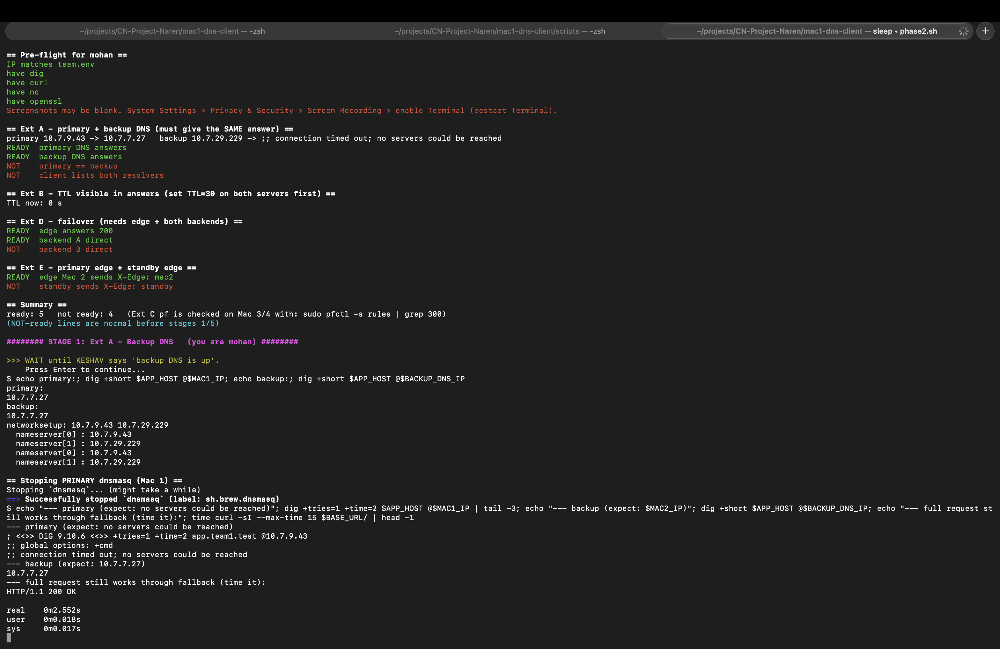
*Mohan: primary dead, backup answers, curl still 200*

Raw logs: `mac1-dns-client/evidence/EA0-both-answer.txt`, `mac1-dns-client/evidence/EA2-failover.txt`, `mac3-backend-a/evidence/EA1-backup-dns.txt`

### Ext B: TTL and caching  `PASS`

**Owner:** Mohan (+ Keshav)

**What we did:** With TTL=30 we change the DNS record to another IP while a script watches two views: dig straight to the server (always fresh) and the Mac's own resolver cache.

**Commands:**
```bash
TTL=30 ./scripts/setup_dnsmasq.sh primary
./scripts/demo_ttl.sh  (recording)
APP_IP=10.7.25.176 TTL=30 ./scripts/setup_dnsmasq.sh primary  (change record)
flush cache
```

**What the evidence shows:**
- 11:05:51: dig already shows the new IP 10.7.25.176.
- The system resolver kept the OLD IP 10.7.7.27 until 11:06:22, more than 30 s.
- At 11:06:27 it switched: this is right after the scheduled cache flush. (We cannot separate natural TTL expiry from the flush here, but the old answer clearly survived the change.)

**Why it works:** A cached answer can outlive a record change by up to the TTL. For a planned migration you lower the TTL first. TTL is the price of caching.

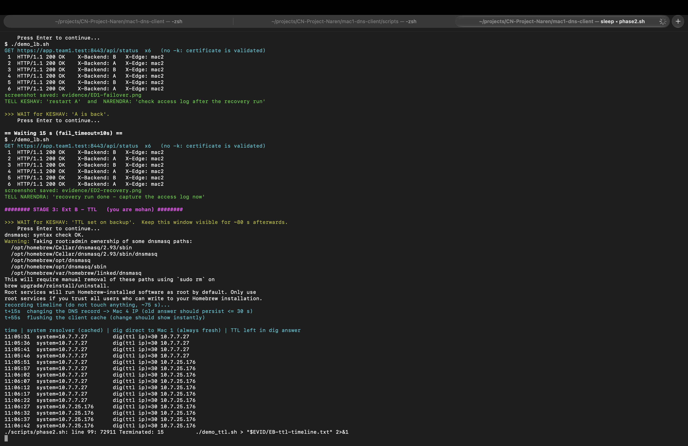
*Mohan: timeline of dig (fresh) versus system resolver (cached)*

Raw logs: `mac1-dns-client/evidence/EB-ttl-timeline.txt`

### Ext C: Service isolation with pf (firewall)  `PASS WITH NOTES`

**Owner:** Keshav, Mayank, Narendra, Mohan

**What we did:** The backends' ports should only accept connections from the edge (Mac 2). Direct access from a client (Mac 1) must time out, but the site through the edge must still work.

**Commands:**
```bash
Keshav: ./scripts/isolate_pf.sh 3001
Mayank: ./scripts/isolate_pf.sh 3002
Narendra and Mohan: test
Both: ./scripts/rollback_pf.sh
```

**What the evidence shows:**
- DONE: the rules are active on both backends: 'pass in quick ... from 10.7.7.27 to any port 3001/3002' followed by 'block drop in quick ... port 3001/3002'.
- DONE: rollback_pf.sh printed 'rollback OK (rules identical to before)' on both Macs, so the firewall was restored.
- NOT SHOWN, edge test: Narendra's curl failed after 2 ms ('Couldn't connect'). The screenshot shows why: macOS asked 'Allow iTerm to find devices on local networks?' and blocked LAN traffic until allowed.
- NOT SHOWN, client test: Mohan's direct curl to both backends returned 200, so pf was not active at the moment he ran it (the stages were run out of order).

**Why it works:** Least privilege: only the component that needs the port gets it. In the cloud this is a security group. Caveat: source-IP rules can be spoofed on a shared LAN, so this is a concept demo.

> **Note:** The firewall rules and the rollback are fully proven by the four pf screenshots. The two connectivity tests were taken at the wrong moment: Mohan's direct curl ran before pf was active (it returned 200) and Narendra's curl was stopped by the macOS Local Network prompt. So those two screenshots do not show the block. What the rules do: only 10.7.7.27 (the edge) may open TCP 3001/3002, every other source is dropped silently ('block drop'), so a client like Mac 1 would see a timeout while the site through the edge keeps working. We did not repeat the test.

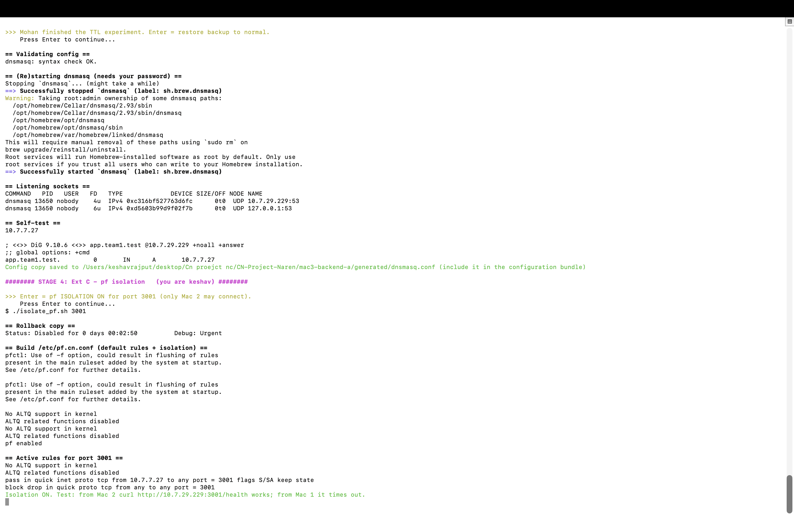
*Keshav: pf rules on port 3001*

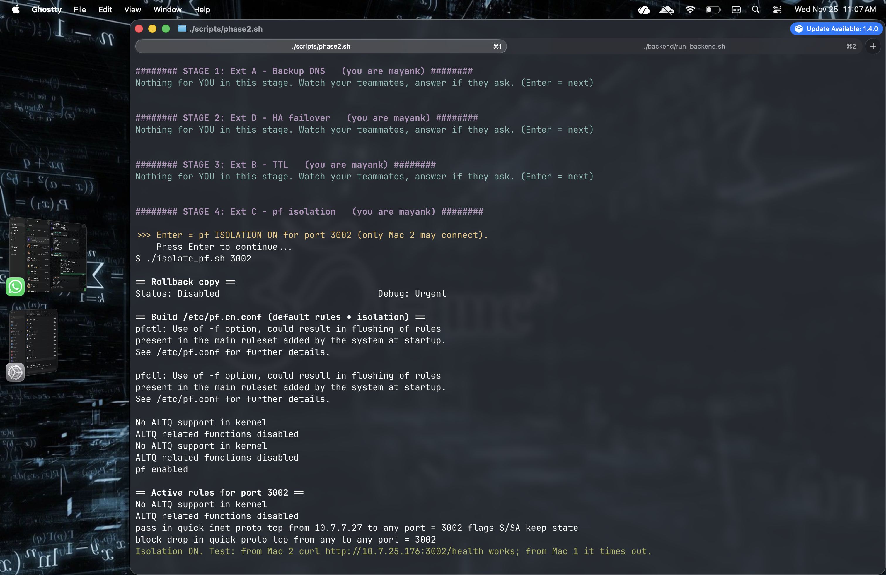
*Mayank: pf rules on port 3002*


*Keshav: rollback OK*


*Mayank: rollback OK*

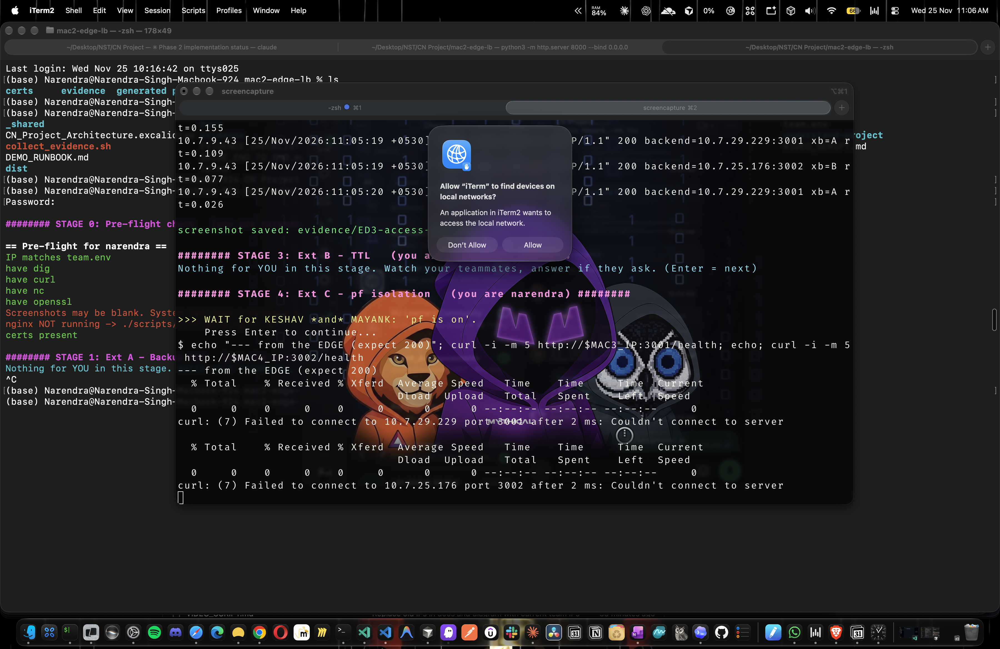
*Narendra: edge test stopped by the macOS Local Network prompt*


*Mohan: direct access still worked, pf was not active yet*

### Ext D: High availability (failover)  `PASS WITH NOTES`

**Owner:** Keshav + Mohan + Narendra

**What we did:** Stop Backend A: every answer must come from B and users must notice nothing. Start A again and the A/B alternation returns.

**Commands:**
```bash
Keshav stops Backend A
Mohan: ./scripts/demo_lb.sh
Keshav restarts A, wait 15 s
Mohan: ./scripts/demo_lb.sh
Narendra: tail the nginx access log
```

**What the evidence shows:**
- The stop did not work: Keshav's check still shows 'Python ... TCP *:3001 (LISTEN)'. The script used pkill with 'python', but macOS names the process 'Python', so nothing was killed.
- So Mohan's run still alternates A,B,A,B and is not a failover proof.
- Useful proof already in the log: the lines 'backend=10.7.25.176:3002, 10.7.29.229:3001 ... rt=2.123' (10:59:56) and 'rt=1.029' (11:04:22) show nginx tried :3002 first, failed within its 2 s connect timeout, and automatically served the request from :3001. That is proxy_next_upstream working.

**Why it works:** Passive health checks: after max_fails=2 errors nginx skips a server for fail_timeout=10 s and retries the request on the next one. The single nginx edge is still the point of failure (Ext E).

> **Note:** The stop command missed the process, so this run does not show a clean 'all B' answer set. The proof of failover is the access-log lines with two upstreams (rt=2.123 and rt=1.029): nginx tried :3002, failed within the 2 s proxy_connect_timeout and served the request from :3001. The behaviour is set in nginx.conf: max_fails=2, fail_timeout=10s, proxy_next_upstream error timeout http_502 http_503 http_504. The script has since been fixed to stop the backend by port.


*Keshav: port 3001 still LISTEN, so A was not stopped*

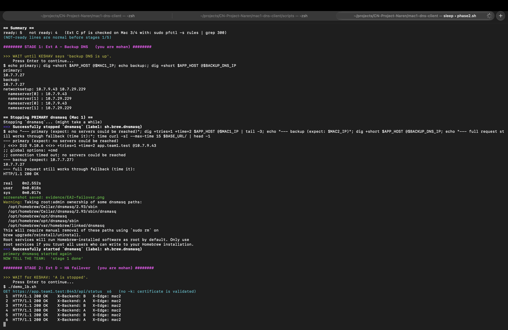
*Mohan: run during the failed stop*


*Mohan: recovery run*

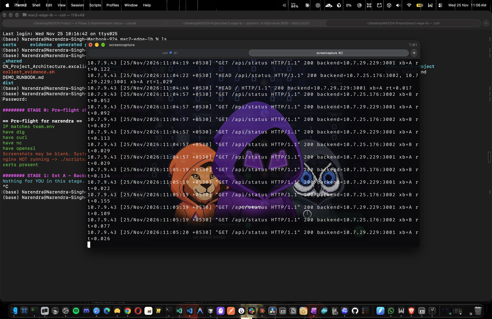
*Narendra: access log, note the two-upstream retry lines*

Raw logs: `mac2-edge-lb/evidence/ED3-access-log.txt`

### Ext E: Standby edge and DNS cutover  `PASS`

**Owner:** Keshav + Mohan + Narendra

**What we did:** A second nginx on Mac 3 (the standby) uses the same certificate. We then change the DNS record from Mac 2 to Mac 3 and watch the traffic move.

**Commands:**
```bash
Narendra: ./scripts/serve_certs.sh  (hands the certificate and key to Keshav only)
Keshav: ./scripts/configure_nginx.sh standby
Mohan: record change to 10.7.29.229 while ./scripts/demo_edge.sh runs
```

**What the evidence shows:**
- Standby answered directly: HTTP/2 200, nginx listening on *:8443 on Mac 3 (EE1).
- Timeline: edge=mac2 with ip 10.7.7.27 until 11:08:07; one '?' sample at 11:08:14 (resolver switching); from 11:08:19 edge=standby with ip 10.7.29.229.
- The record was changed at about 11:07:51, so the switch took about 28 s, matching the 30 s TTL. Backends kept alternating A/B behind the standby.
- phase2_check.sh at the end reports 9 ready, 0 not ready, including 'standby sends X-Edge: standby'.

**Why it works:** This removes the single point of failure by hand: the DNS record decides which edge gets users, and the TTL decides how fast they move. The same certificate works because it holds names, not IPs.

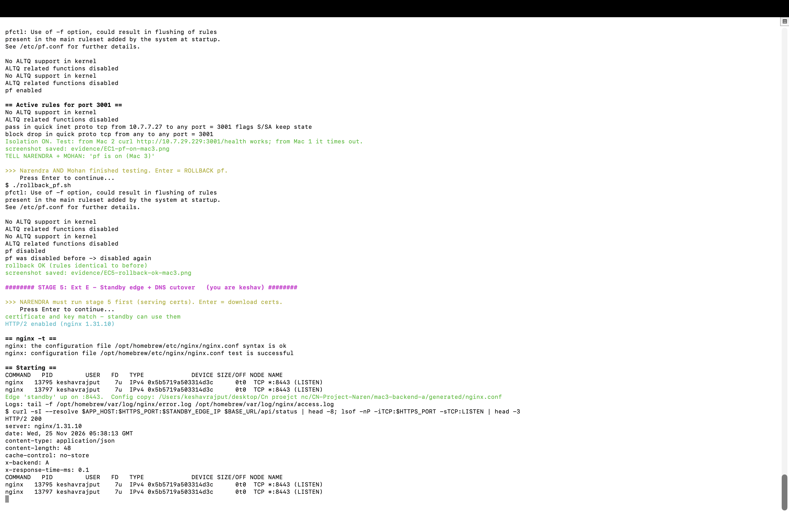
*Keshav: standby nginx up on Mac 3*

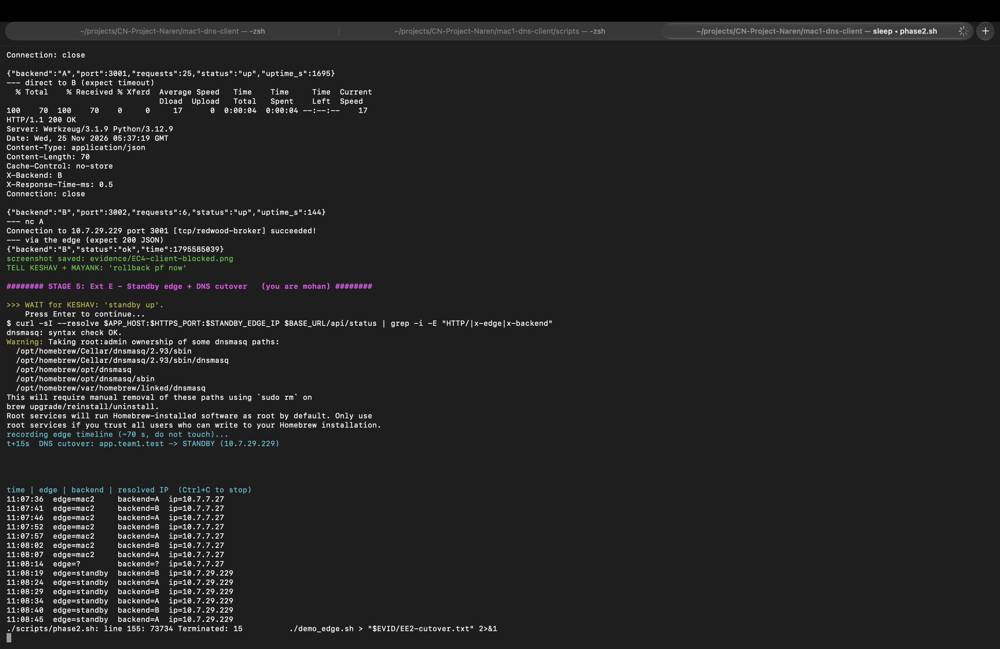
*Mohan: edge flips from mac2 to standby*

Raw logs: `mac1-dns-client/evidence/EE2-cutover.txt`, `mac3-backend-a/evidence/EE1-standby.txt`

### Ext F: Troubleshooting  `PASS WITH NOTES`

**Owner:** Mohan + Narendra

**What we did:** Narendra breaks something (stops nginx) and Mohan finds it with diagnose.sh by reading the layers in order.

**Commands:**
```bash
Mohan: ./scripts/diagnose.sh (healthy)
Narendra: nginx -s stop
Mohan: ./scripts/diagnose.sh (fault)
Narendra restarts nginx
Mohan: ./scripts/diagnose.sh; ./scripts/phase2_check.sh
```

**What the evidence shows:**
- Healthy run: every layer PASS (EF1).
- Narendra's log confirms 'nginx is STOPPED (fault injected)' (EF0), but Mohan's 'fault' run is also all PASS, so he ran it before nginx was stopped. It does not show the fault.
- Final check: all PASS and phase2_check says 9 ready, 0 not ready (EF3).

**Why it works:** Expected result of the real test: the first FAIL appears at layer 2 (TCP, edge port 8443 not open) and everything above it fails too. That tells you the edge is down, not DNS and not TLS.

> **Note:** Mohan's 'fault' run happened before nginx was stopped, so it shows all PASS; Narendra's log (EF0) proves nginx was stopped afterwards. For a real example of a broken layer see the failure demos in Phase 1: with the edge up and both backends down, DNS and TLS pass and HTTP returns 502, which is exactly where diagnose.sh prints its first FAIL. If the edge itself is stopped, the first FAIL moves to layer 2 (TCP, port 8443 closed).


*Healthy*

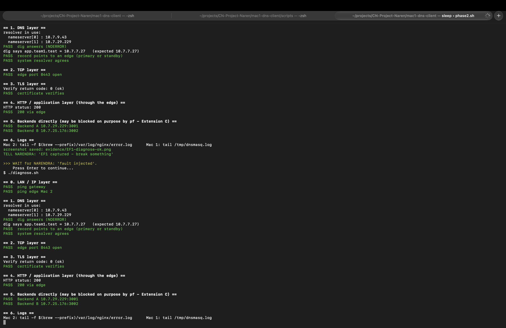
*Fault run: all PASS, nginx was not stopped yet*

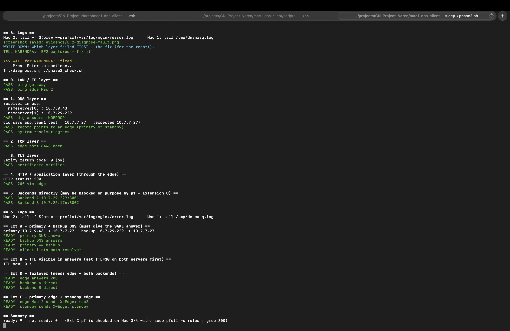
*Final check: 9 ready, 0 not ready*

Raw logs: `mac2-edge-lb/evidence/EF0-fault.txt`


## 5. Problems we hit and how we fixed them

| Problem | What happened and the fix |
|---|---|
| Campus DHCP changed every IP | Scripts refused to run ('does not have IP'). We ran setup_team.sh with the new IPs, pushed team.env and everyone re-cloned. Lesson: IPs are in one file; certificates use names, so they did not need to be rebuilt. |
| Cloudflare WARP on Mohan's Mac | DNS showed 127.0.2.2, so our DNS server was ignored. The script printed a red warning, WARP was turned off. |
| diagnose.sh showed a false TLS FAIL | LibreSSL's openssl does not use the macOS keychain. Fixed by passing the CA file with -CAfile. |
| macOS Local Network permission | iTerm was not allowed to talk to LAN devices, so curl failed after 2 ms. Fix: System Settings > Privacy & Security > Local Network. |
| Backend A would not stop | pkill -f 'python backend.py' is case sensitive; macOS shows 'Python'. Fixed by stopping whatever listens on port 3001. |
| Stages run out of order | Some tests ran before the fault or the firewall was in place. The scripts now print a warning when the expected condition is missing. |
| Screenshots | Auto-screenshots need Screen Recording permission for the terminal app. The text output (.txt) is saved next to every screenshot as a backup. |

## 6. Limitations and honest notes

- The Wireshark capture file phase1.pcapng was not recorded. The packet flow is explained in the Task G section and the TLS handshake messages are shown by demo_tls.sh.
- Caching (Task F) and failure demos 1, 4 and 5 were reproduced on Mac 2 after the lab session, not during it, because the lab backends had been switched off. They are labelled REPRODUCED.
- Ext C connectivity test, Ext D full failover and the Ext F fault run were taken at the wrong moment (see the notes). The configuration and the supporting logs are complete.
- Failures 2 and 3 are explained from existing evidence, not shown as separate screenshots.
- Chapter 9 of Docs/CN_Project_Master.pdf: paste the numbers and screenshots from this report.

## 7. Viva: short answers

**Why does DNS not connect to the server?** DNS only maps a name to an IP using UDP port 53. TCP, TLS and HTTP start afterwards, towards that IP.

**What did the backup DNS test show?** With the primary stopped the first query timed out, the resolver used the second server, and the page still loaded in 2.55 s.

**What is TTL and what did we measure?** TTL is how long an answer may be cached. After the record change the Mac kept the old IP for 30+ seconds. The cutover to the standby took about 28 s.

**How does the certificate chain work?** The client trusts team1 Local CA, the CA signed the edge certificate, and the name app.team1.test is in its SAN. We proved it with 'Verify return code: 0 (ok)'.

**How does nginx survive a dead backend?** max_fails=2 and fail_timeout=10 s mark it down, proxy_next_upstream retries on the other backend. The log shows a request tried :3002 and was served by :3001 after 2 s.

**What is still a single point of failure?** The one nginx edge. The standby edge plus a DNS change fixes it manually; keepalived/VRRP or a cloud load balancer would make it automatic.

**What does pf do and how is it like the cloud?** It filters packets by source and port. Only Mac 2 may reach the backend ports, like a security group. Source IPs can be spoofed on a LAN, so it is a demo of the idea.

**Why was the first TLS check red but curl green?** curl uses the macOS keychain, the old check used openssl which does not. We pointed openssl at the CA file.

